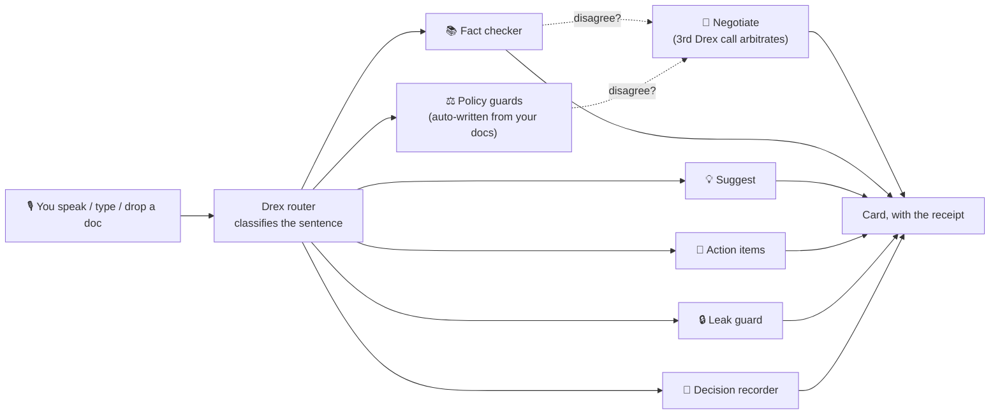

# 🦖 Hallucinot

### *For once, AI fixes **human** hallucinations.*

Everyone's busy making sure the AI doesn't make things up. Nobody's watching the meeting, where a rep just promised a discount the contract doesn't allow, a teammate stated a decision that got reversed last week, or someone read out an API key out loud. Hallucinot does — live, on every sentence, with the receipt shown.

It's judged by **Drex**: not a wrapper around one model call, but a small team of agents — each one a separate Drex decision — that check, flag, and when they disagree with each other, *negotiate*.

> 🏁 Built for **Drexathon 2026**, entering as a **Wildcard** — because our demo isn't a sandbox, it's running on a real problem right now: Hallucinot is helping judge Drexathon itself.

<p>
  <a href="https://quench-humped-excluding.ngrok-free.dev/"></a>
  
  
</p>

---

## What it actually does

Say something, type something, or just leave it on a tab. Hallucinot finds the piece of your knowledge base that matters, and shows you one of four verdicts:

| Verdict | Meaning |
|---|---|
| ✅ **Checks out** | Matches the source. Say on. |
| 🦖 **Hallucination** | Contradicts the source — shown with the exact line, and the corrected sentence to say instead. |
| 🔵 **Context** | No contradiction, just useful background from the source. |
| 🤫 **Stays quiet** | Nothing to flag. Most sentences, correctly, get no card at all. |

Nothing is generated from a model's memory. Every card traces back to a real line in a real document.

## The part that makes this a *team*, not a tool

A sentence doesn't get one verdict from one model call. It goes through a router, then a panel — each member is its own Drex decision, running in parallel:



- **📚 Fact checker** — does this contradict the documents?
- **💡 Suggest** — is this a question the docs already answer? Show it, unprompted.
- **⚖️ Policy guards** — these **write themselves**. Every rule-like sentence in your own documents ("requires…", "only…", "cannot…") becomes a standing checker, automatically, no config.
- **📝 Action items** — is someone committing to send, fix, schedule, or follow up on something?
- **🔒 Leak guard** — is a password, API key, or personal data being said out loud?
- **🧠 Decision recorder** — is this a new decision being announced as settled fact? It remembers, with no clicks, and flags later statements that contradict it as "⚠️ this changed today."
- **🚩 Custom agents** — type any rule in plain English with **+ Add agent** and it joins the panel.

When two of them disagree on the same sentence — say, **Policy guard** flags the wording of a discount promise while **Fact checker** independently matches it to a clause that already authorizes it — a **third Drex call arbitrates**, and you get one resolved 🤝 card instead of two contradicting ones.

## The numbers

`eval/cases.py` — 50 real meeting lines, judged against 300 real `pallets/flask` pull requests.

| | Drex | Claude Opus 5.5 |
|---|---|---|
| Accuracy | **47 / 50** | 47 / 50 |
| Median latency | **0.38s** | 2.2s |
| Cost per check | **~1/500th** | — |

Same accuracy. ~6× faster. ~500× cheaper. Every miss on both sides came from the retrieval step, not either model.

## Run it

```bash
git clone https://github.com/Mahak202/hallucinot && cd hallucinot
echo "YOUR_NACE_KEY" > .nace_key      # or: export NACE_API_KEY=...
python3 server.py
```

Open **http://localhost:8787** in Chrome. Click **Start listening**, or just type a sentence and hit enter.

Bring your own knowledge base:

```bash
python3 server.py --folder ~/path/to/docs --repo owner/name
```

Without flags it loads `kb/company/` (a fictional "Quokka Analytics" contract, Q3 metrics, a postmortem, a design doc) plus real `pallets/flask` PRs, and `kb/classroom/` (Bio 101 notes) as a second workspace.

### As a Chrome extension (check any tab)

1. Start the server (above).
2. `chrome://extensions` → **Developer mode** → **Load unpacked** → select `extension/`.
3. Click the toolbar icon. It checks whatever tab you're on — Zoom chat, Gmail, a doc, anywhere.

### Check a whole document at once

Open **📄 Check a document**, paste text or drop a PDF, and every sentence gets judged in parallel — a full document in about a second. Built-in samples: a chatbot answer, a student poster, a customer email.

## Try a few lines

| Say | What happens |
|---|---|
| "Sure, I can give you 20% off if you sign today" | ⚖️ Policy guard fires |
| "We're giving Acme a 25% credit since uptime dropped below 99%" | ⚖️ would normally fire — but 📚 Fact checker matches the SLA's automatic credit clause — 🤝 Drex arbitrates and stands the flag down |
| "Our SLA with Acme is 99.99% uptime" → "Sorry, I meant 99.9%" | 🦖 then ✅ — self-correction, learned |
| "I'll send you the renewal quote by Friday" | 📝 Action items |
| "The staging API key is sk-live-8812" | 🔒 Leak guard |
| "Let's grab lunch after this" | 🤫 stays quiet |

## Where this fits — Drexathon tracks

| 🦖 Apex Predator | 🧬 Swarm Intelligence | 🎨 Wildcard *(our entry)* |
|---|---|---|
| Drex vs. the Giants — benchmarked head-to-head against Claude Opus above | Agents that coordinate and negotiate, every call made by Drex | We're running this on a live problem right now: Hallucinot is judging Drexathon itself, reading every team's demo and repo to reach the call |

## Built with

**Nace** — `Drex` makes every decision: the router, each agent, the verdicts, the fix, the negotiation. `NDI` turns uploaded PDFs, scans, slides, and Word docs into knowledge — and the rules it finds inside them become new agents automatically. `Intern` gets the meeting recap in Slack and follows up on action items.

**Partners** — Adobe Express & Firefly (poster, slides, mascot), DeepInfra running Llama 3.3 70B as the optional "System 2" recap writer.

## Honest limits

Demo data is fictional (Quokka Analytics, Bio 101) plus one public repo. Retrieval is keyword-based, not embeddings — the few misses in the benchmark came from there, not from Drex's judgment. Learned decisions live in memory for the session, not a database.

---

*Built by **Harsh** & **Mahak** for Drexathon 2026. This is Mahak's copy of the project — the primary team repo lives at [harsh-neubird/hallucinot](https://github.com/harsh-neubird/hallucinot).*
